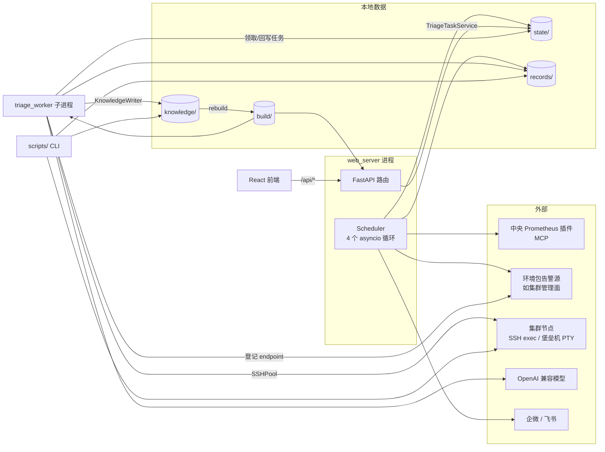
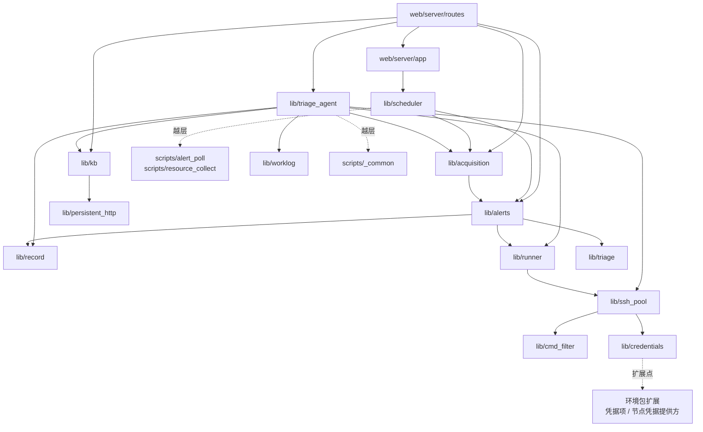
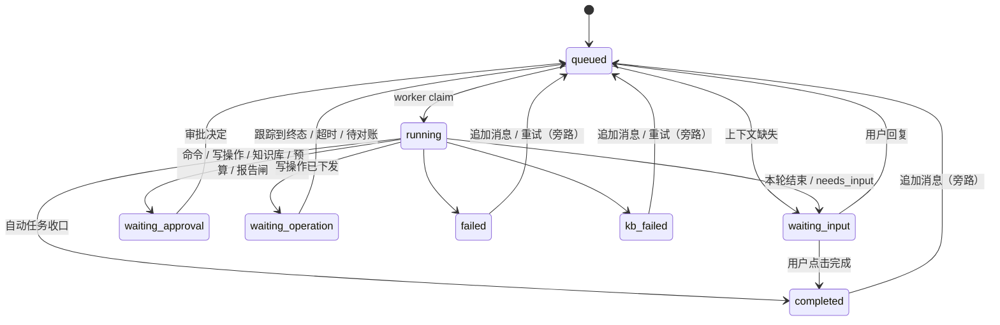

# ops-agent 架构总览

> 一次读懂 ops-agent 的代码分层、运行时拓扑、主链路与数据落点。本文描述**现状**，依据
> 2026-09-29 `main` 工作区源码与 codegraph 调用图逐项核对；约束规则以 [CLAUDE.md](../CLAUDE.md)
> 为准，功能介绍见 [README.md](../README.md)，计划见 [ROADMAP.md](../ROADMAP.md)。
> 新增子系统、运行时循环、存储落点或分层变化时同步更新本文。

## 1. 总览

ops-agent 由**一个常驻 Web 中台进程 + 一个排查 worker 子进程 + 一组 CLI 脚本**组成，三者共享同一套
`lib/`，彼此只通过本地文件（`state/`、`records/`、`knowledge/`、`build/`）交汇：

- **状态获取层（零 LLM）**：告警轮询与资源采集定时经 Prometheus 插件（MCP）取数、环境包告警源扩展按集群拉告警 → 事件流与快照 → 中台展示、按来源推送
- **Agent-Ops（LLM 按需介入）**：Web 建任务 → worker 跑 Agent Loop → 受控工具 → SSHPool / 只读 HTTP → 报告、产物、知识草稿
- **知识库**：Markdown 为唯一真源 → 统一 rebuild 生成路由与检索索引 → 被告警路由、症状召回和 ContextPack 消费



## 2. 仓库与目录

主仓只装代码；知识库仓与 records 仓都在主仓之外（默认 `../knowledge`、`../records`），分别由
`lib.kb.bases.resolve_knowledge_root`、`lib.data_root.resolve_records_root` 按 `paths.local.yaml` 定位，
缺省落数据根下。下文 `records/...` 均指记录根下的路径。
知识库根下每个带 `kb.yaml` 的子目录是一个库（如 `cluster/` 与按任务类型分组的 flat 库），文档 ID 带库前缀，
旧 ID 经 `_redirects.yaml` 映射。详见 README「三仓布局」。

| 目录 | 职责 | 规模（Python/TS 行） |
|---|---|---|
| `lib/` | 全部业务与基础设施实现，传输无关 | 约 3.7 万 |
| `scripts/` | CLI 入口、定时 tick 实现、采集器、构建与迁移工具 | 约 0.75 万 |
| `web/server/` | FastAPI 装配（`app.py`）与 17 个路由模块 | 约 0.53 万 |
| `web/frontend/` | React + Vite 中台前端，产物 `dist/` 不入库 | 约 1.7 万 |
| `tests/` | 168 个 pytest 文件（前端另有 `web/frontend/tests/`） | 约 3.4 万 |
| `config/` | 仅本机私有配置的示例（`*.example.yaml`）；环境数据随环境包 | — |
| `envs/example/` | 虚构示例环境包，未挂载环境数据时的回退；真实环境包是应用数据（`<数据根>/env/` 或 `env_pack`），结构同：`env.yaml`（环境、时区、集群与角色、清单来源、Python 扩展点）、`config/` 环境数据、`playbooks/`、专有名词词表 | — |
| `playbooks/` | 节点侧只读排查脚本的公共步骤库 `_lib/`；具体脚本随环境包 | — |
| `desktop/` | Windows 外壳 `OpsAgent.exe`（Go）：托盘面板、托管中台、签名更新与回退；`cmd/opsagent-release` 发布签名 | — |
| `packaging/` | 包内说明、Linux 启动脚本与 systemd 模板、Windows 冒烟与实机验收脚本；构建见 `scripts/build_package.py` | — |
| `skills/` | LLM 宿主技能（ops-triage / ops-deep-dive / kb-write / log-work / weekly-report），只调 `scripts/` | — |

## 3. 代码分层与依赖

按 codegraph `imports` 边（排除测试）聚合出的真实依赖，自下而上五层：

| 层 | 模块 | 说明 |
|---|---|---|
| L0 基础设施 | `file_lock` `config` `network_env` `sanitize` `persistent_http` `credentials`(+`credential_cache`;凭据项与节点凭据提供方由环境包扩展) `log_catalog` | 锁、配置、直连网络、脱敏、HTTP 连接池、凭证 |
| L1 执行出口 | `cmd_filter` → `ssh_pool`(+`pty_channel`)；`playbook` `playbook_lint` `runner`；`record`；`triage` | 唯一 SSH 出口、红线、playbook 执行、排查落档、告警路由匹配 |
| L1.5 数据层 | `data_root`(数据根、记录根)、`lib/datastore`(用户/工作记录/排查记录/工作项与计划) | 运行时路径唯一入口;records 读写与作者经此,二阶段在其上接共享服务 |
| L1.5 环境与资源 | `lib/envpack`(环境包加载、角色、时区、平台枚举字段、专有名词 lint)、`lib/inventory`(资源模型与清单) | 平台集合、节点归一与资源 ID 的唯一来源 |
| L1.5 插件 | `lib/plugins`(注册、MCP 薄客户端、工具清单缓存与准入、结果归一) | 外部系统只读查询的唯一出口,依赖 envpack/credentials/sanitize |
| L2 领域子系统 | `lib/alerts` `lib/acquisition` `lib/kb` `lib/triage_agent` `worklog` `weekly_report` `lib/work_items` `lib/graphs` | 各自一条业务链路 |
| L3 进程内编排 | `lib/scheduler` | 中台内嵌定时调度 |
| L4 入口 | `web/server`、`scripts/`、`skills/` | HTTP、CLI、LLM 宿主 |



关键事实：

- `lib/kb` 除 `file_lock` 与 `persistent_http` 外只依赖 `lib/envpack`（平台集合、标签）
- `lib/inventory` 的过渡来源适配器（`sources/legacy.py`）在函数内延迟 import `lib.kb.topology` 的组件→服务映射，M4 由插件拓扑替代
- `lib/triage_agent` 是汇聚点，依赖 16 个模块，其中最重的是 `lib/kb` 与 `lib/record`
- `lib/acquisition → lib/alerts`：资源风险通知复用告警的模板与渠道，每日维护顺带清理告警历史
- 已核对的边界约束：`lib/triage_agent` 不 import fastapi/starlette；路由层不 import SSHPool；paramiko
  只出现在 [lib/ssh_pool.py](../lib/ssh_pool.py)

已知越层（`lib` / `web` 反向依赖 `scripts`）：

| 位置 | 依赖 | 原因 |
|---|---|---|
| [lib/scheduler.py:14](../lib/scheduler.py) | `scripts.alert_poll`、`scripts.resource_collect` | 定时 tick 实现在脚本层，scheduler 以 `asyncio.to_thread(run, argv)` 调用 |
| [lib/triage_agent/actions.py:44](../lib/triage_agent/actions.py) | `scripts._common.build_pool_for_platform` | SSHPool 工厂函数放在脚本层 |
| `lib/envpack/ext.py`、`lib/credential_probe.py` | 同上（函数内延迟 import） | 同上 |
| [web/server/app.py:32](../web/server/app.py) | `scripts.node_credentials` | 启动时复用 CLI 入口做节点凭据初始化 |

## 4. 运行时拓扑

| 进程 / 执行单元 | 入口 | 内容 |
|---|---|---|
| Windows 外壳 | `desktop/`(`OpsAgent.exe`) | 注入数据根拉起中台(python.exe + CREATE_NO_WINDOW)、探活与托盘;防睡眠电源请求;单实例;检查/验签/切换/回退更新 |
| Linux CLI | `scripts/opsagent.py` | `serve` 前台跑中台;`start/stop/status` 经 `lib/apphost/controller.py` 后台托管;`upgrade` 切 `app/current` |
| Web 中台进程 | `scripts/web_server.py` | 清代理直连 → `state/web_server.lock` 单实例 → `create_app` → uvicorn |
| └ lifespan | `web/server/app.py` | mac 下先经环境包提供方初始化缺失的节点凭据 → `Scheduler.start()` → 调谐 triage worker |
| └ `alert_poll_loop` | `lib/scheduler.py` | 默认 300s，`to_thread` 跑 `scripts/alert_poll.run` |
| └ `resource_collection_loop` | 同上 | 默认 300s，`to_thread` 跑 `scripts/resource_collect.run` |
| └ `acquisition_maintenance_loop` | 同上 | 每日封存 JSONL、按保留期清理 |
| └ `_graph_weekly_loop`(每张 `refresh: weekly` 图谱一个) | 同上 | 每周图谱全量校准 |
| └ 周报后台任务 | `lib/weekly_report_jobs.py` | ThreadPoolExecutor 执行四阶段 LLM 周报 |
| triage worker 子进程 | `scripts/triage_worker.py` | `LocalProcessSupervisor` 在 `config/model.local.yaml` 存在时 Popen 拉起；`TriageWorker.run_forever` 领取任务 → `TriageOrchestrator.run` |
| CLI 脚本 | `scripts/*.py` | 人工排查、采集、构建、迁移，按需运行 |

- 各循环独立失败、单 job 不重入；轮询是否真在跑以 task 存活 + `last_tick_at` 判定，不看开关
- Web 进程与 worker 不共享内存，唯一交汇点是 `state/triage-tasks/`（FileLock + 原子替换）：Web 只经
  `TriageTaskService` 写任务，节点动作只由 worker 发起
- 中台不热重载：改 `lib/` 或 `web/server/` 后必须重启进程，worker 随之重建
- 停止中台写 `state/web_server.stop` → uvicorn 正常退出、lifespan 停 worker；进程退出前仍要等 `to_thread` 在途采集跑完（资源一轮约 19s），外壳/CLI 45s 超时才强杀进程树

## 5. 主链路

### 5.1 告警管道（零 LLM）

```text
alert_poll_loop → scripts/alert_poll.run
  → collect_events       lib/alerts/sources：Prometheus 插件（当前告警 + 告警时段 + 规则）+ 环境包扩展源，按段回放，overlap 续拉
  → _process_tick        规则级覆盖 → profiles 分级 → 动态 flap / 常驻 → 跨源 dedup → AlertsState.transition
  → 落盘                 records/alerts/*.jsonl（真源） + state/timeline.db（投影） + state/alerts.json（活跃快照）
  → notify               企微 / 飞书，按来源推送开关（关了只是不推送），失败进渠道补发队列
  → triage_runner        可选（auto_triage_enabled 默认关）：精确 routing → run_playbook 只读采证，run_id 前缀 al-
```

告警业务逻辑主体（`_process_tick`，622 行）位于 `scripts/alert_poll.py`，而非 `lib/alerts/`。

### 5.2 资源采集与风险分析（零 LLM、零 SSH）

```text
resource_collection_loop → scripts/resource_collect.run
  → collect_resource_snapshots     lib/acquisition/resources：Prometheus 插件（快照 + 采集目标 + 具名查询），按 platform 标签动态发现平台
  → append_snapshot                records/telemetry/resources/YYYY-MM-DD.jsonl（当天只追加）
  → save_catalog                   state/resource-catalog.json（服务能力目录）
  → analyze_resource_history       阈值 = config/resource-metrics.yaml 默认 + state 手动覆盖
  → save_risks                     state/resource-risks.json
  → sync_resource_risk_notifications   复用 lib/alerts 模板与渠道，按 finding key 去重
```

资源风险卡片可经 `POST /api/resource-risks/{risk_ref}/triage-task` 生成 `RiskSeed` 并创建 Investigation 任务，进入 5.3。

### 5.3 Agent-Ops 任务

**创建（Web 进程）**：`POST /api/triage-tasks` → `TriageTaskService.create_task`：

1. `TaskClassifier` 程序预判 + 同一模型一次无工具分类（标题、task type、intent、平台、节点、服务/组件）
2. 两者冲突取程序判断(程序判 default 时取模型),判断留审计;运行时目标缺失 → 发起上下文澄清
3. 模型与预算快照写入任务,`harness_tier` 固化为 `autonomous`
4. `TaskStore` 写 `state/triage-tasks/<id>/`，状态 `queued`

**执行（worker 进程）**：[AgentRuntime.run](../lib/agent_runtime/loop.py) 每次领取执行一段
(A3.7 删除旧编排器;`harness_tier` 为空/structured 的旧任务只读,排队即被关闭):

1. **消费挂起决策**：写操作(跟踪 / 对账 / 兑现,最先)→ worklog 审批 → 手动 worklog → 预算续期 → 知识草稿审批 → 报告闸 → 命令审批
2. **首次执行**：固化档位开关,按类型准备开场材料(qa 快照 / investigation、artifact 引用清单与 RiskSeed /
   alert 精确路由 playbook 预跑),只追加为一条 harness_notice
3. **Loop**：软预算到顶时人工任务挂续期闸、自动任务进收口回合;硬上限到顶进收口回合 →
   `model.complete`(稳定 system 前缀 + 只追加历史)→ 无工具调用即回答或提问 → 有工具调用按批次执行
4. **单次工具调用**：`shell` → `command_guard` → 三档 `decide` → `CommandApprovals` → `ActionGateway` →
   `RemoteSession` → `SSHPool.run`;诊断 / 只读 HTTP 诊断照旧(MySQL 经插件);`ToolResult` 写入 invocations 与事件流
5. **收口**：`finish` 按猜测三态核验(证据原文由 Harness 从 records 摘录,只降级不驳回),人工任务结论无依据挂报告闸;
   收口回合仍不收口则写未收口报告;`finally` 释放本次执行的 RemoteSession
6. **底座模块**:审批原语 `approvals`、调用落档与闭合 `invocations`、批次策略 `tool_batch`、续期闸 `budget_gate`、
   命令审批 `command_approvals`、消息重建 `history`、worklog `worklog_flow`、知识草稿审批 `kb_review`、报告闸 `report_gate`、
   插件写操作 `write_operations`(计划 → 审批 → Harness 签令牌执行 → worker 空闲轮询跟踪 → 记录 / 报告 / oplog)



`queued`、`running`、`waiting_*` 均可转 `cancelled`。状态机分两套规则：worker 侧 `transition()` 受
`task_store._ALLOWED_TRANSITIONS` 约束（终态出边为空）；用户侧 `resume_with_message` / `retry_failed`
另有状态白名单，仅限人工任务。修改状态语义需两处同步。

### 5.4 知识库

- **写**：只有两个业务入口——worker 内的 `KnowledgeSink`（人工审批后）与 `scripts/kb_import.py`，二者共用
  [KnowledgeWriter](../lib/kb/writer.py)：契约渲染 → lint → 原子写 → rebuild，失败回滚；
  未指定库时落默认库（首个 platform_service 库），flat 库新文档落库根
- **库与路径**：[bases](../lib/kb/bases.py) 负责库发现、文档遍历（`iter_documents`）、库内路径拆分与旧 ID 映射，
  各消费者按库内路径推断平台/服务/组件，不再假设知识库根即平台目录
- **重建**：`lib/kb/rebuild`（`build_wiki.py` 同入口）：同步 `_index.md` 受控区 → `routing.json` → `wiki.html`
  → `kb-recall.sqlite`（FTS5）→ `kb-retrieval.sqlite`（chunk）→ 可选向量库；另生成 `kb-topology.*`
- **读**（互相隔离）：

| 消费者 | 读取 | 入口 |
|---|---|---|
| 告警精确路由 | `build/routing.json` | `lib/triage.match_alert`（AlertAgent、告警 triage_runner、`triage_match.py`） |
| 人工症状召回 | `build/kb-recall.sqlite` | `lib/kb/recall`（Top 5，`search_kb_candidates`） |
| ContextPack | `build/kb-retrieval.sqlite`（+ 可选向量/重排） | `lib/kb/retrieval` |
| 中台浏览 | `knowledge/` 源文件（仅全文检索走 recall 索引） | `lib/kb/browse` |

- **晋升**：策略在 `lib/kb/promotion`，执行在 `lib/kb/promote`（frontmatter 行级修改，正文不动）

### 5.5 工作项、工作日志与周报

- **工作项**：`WorkItemStore`(`lib/datastore/work_items.py`)→ `records/work-items/<id>.json`、`plans/<plan_id>.json`（目录锁+原子替换，history 只追加，只取消不删）。
  挂载只存 task/troubleshoot/worklog 引用;`lib/work_items/` 负责粘贴表格解析(`table`)、worklog 归属派生与周期分桶(`links`)、挂载详情(`detail`)、匹配建议(`suggest`)、周报事实(`weekly`)

- **worklog**：`WorklogStore.append`(`lib/datastore`)→ `records/worklog/YYYY-MM-DD.md`（FileLock 追加、事件键幂等、作者行）。
  来源：`ts_conclude` / `patrol_runner` / 告警 triage_runner 自动 emit，Agent-Ops 右侧手动触发（模型增量概括），Web 手动补录，`scripts/worklog_add.py`(log-work skill)
- **周报**：周报后台任务 → `lib/work_items/weekly` 取工作项事实 → `lib/weekly_report` 按 `skills/weekly-report/SKILL.md`(有工作项时加 `references/WORK_ITEMS.md`)四阶段 LLM → DOCX → `records/weekly-reports/`

## 6. 安全边界：模型够得着什么

模型只能提交结构化工具调用，从模型到节点依次经过：

| 层 | 位置 | 职责 |
|---|---|---|
| 工具清单 | `agent_runtime/tools.py` | 任务内不变的模型可见清单(内置 + 首次执行冻结的插件工具);收口回合只开放 `finish` |
| 参数 | 各工具参数校验、`diagnostics` | 诊断参数封闭枚举或受限开放型 + `shlex.quote`;节点限任务集群登记节点 |
| 命令闸 | `command_guard`(+`shell_lex`、`command_grammar`) | 红线 → 结构 → 逐段 → 凭据 → 未登记,取最严;整文件读取前探测大小 |
| 命令策略 | `command_policy`(档位与永久名单)、`command_approvals`、`command_review` | 未登记段走三档;审批后按签名执行原调用;auto 审核模型 |
| 人工闸 | 运行时审批事件 + 前端审批卡 | WRITE、凭据路径、插件写操作(审批后 Harness 签令牌执行)、知识库写入、报告闸、预算续期 |
| 红线 | `cmd_filter`（在 `SSHPool.run` 内） | FORBIDDEN 一律拒，三档都绕不过 |
| 出口 | `ssh_pool`（exec / PTY）；http 诊断；插件（`lib/plugins`，含 MySQL） | 唯一 SSH 出口；http 只由登记 endpoint 拼 URL；插件只调已启用的只读工具,写操作的 execute 只由 Harness 在人工批准后调用，均不经节点 |
| 输出 | `sanitize.redact_secrets` → `lib.record` | 落档与回显前打码 |
| 审计 | `invocations.json` + `messages.jsonl` + `records/troubleshoot/<run_id>/` + oplog | 可恢复、可回放 |

playbook 路径（AlertAgent、告警 triage_runner、`ts_playbook`、`patrol_runner`）经 `runner.run_playbook` →
`SSHPool.push/run`，同样受红线约束。

## 7. 数据与状态落点

除 `config/topology/` 与入库 `config/*.yaml` 外,下表路径都相对**数据根**:`OPS_AGENT_DATA_ROOT`(未设即仓库根),
唯一解析入口 `lib/data_root.py`(`resolve_data_root` / `local_config_path`),`tests/test_data_root_guard.py` 拦截直接拼仓库根。
`records/...` 相对**记录根**(`paths.local.yaml` 的 `records_root`,缺省 `<数据根>/records`,经 `resolve_records_root`)。

| 路径 | 性质 | 写者 | 读者 |
|---|---|---|---|
| `knowledge/**/*.md` | 知识真源（独立仓） | KnowledgeWriter | rebuild、browse |
| `build/routing.json`、`kb-*.sqlite`、`wiki.html`、`kb-topology.*` | 派生物，可重建，不入库 | rebuild | 路由、召回、检索、Web |
| `records/alerts/*.jsonl` | 告警事件流真源 | 告警 tick | timeline 重建、Web |
| `records/telemetry/resources/` | 资源快照真源（跨日 gzip） | 资源 tick、维护循环 | analyzer、图表、QA 工具 |
| `records/troubleshoot/<run_id>/` | 排查 session / report / artifacts | `lib.record`（worker、`ts_*` CLI） | Web 报告、知识库回链 |
| `records/worklog/`、`records/weekly-reports/` | 工作日志、周报 | `lib.worklog`、`lib.weekly_report` | Web、周报 |
| `records/work-items/`(含 `plans/`) | 工作项与计划 | `WorkItemStore`(Web 工作项路由、`worklog_add.py --work-item`) | Web、周报、`scripts/work_items.py` |
| `state/triage-tasks/<id>/` | 任务运行时真源（task.json / messages.jsonl / invocations.json） | TaskStore | Web、worker |
| `state/alerts.json`、`timeline.db`、`alert-catalog.json` | 活跃快照、可重建投影、定义目录 | 告警 tick | Web |
| `state/resource-*.json` | 资源目录、风险、阈值覆盖、通知状态 | 资源 tick、Web 设置 | Web、analyzer |
| `state/*-settings.json`、`notify-channels.json`、`command-policy.json`、`poll-enabled.json` | 机器本地设置 | Web 设置页（经 lib 写侧） | tick、worker |
| `state/graphs/<id>/` | 环境包图谱 | 环境包采集器(经 `lib/graphs`) | Web、检索索引 |
| `state/plugin-catalog.json` | 插件工具清单缓存，可重拉 | 插件页连接测试 | 插件页、任务快照 |
| 环境包 `config/topology/` | 集群拓扑快照 v3(入库,含栈依赖/组件依赖/端口)与人工依赖登记 | 环境包采集器 / 人工 | build_topology、服务概览生成区、检索依赖扩展 |
| `config/*.yaml` | 入库配置 | 人工 / 采集器 | 全部 |
| `config/model.local.yaml`、`credentials.json`、`auth-profiles.json`、`vector.local.yaml`、`paths.local.yaml`、`local-dev.yaml`、`plugins.local.yaml` | 本机私有配置（gitignore，随数据根） | 设置页 / 人工 | worker、SSHPool、检索、插件 |

## 8. Web 中台

| 路由模块 | 前缀 | 端点 | 主要依赖 | 写入范围 |
|---|---|---|---|---|
| `triage_tasks` | `/api/triage-tasks`、`/api/troubleshoot-reports` | 19 | TriageTaskService | `state/triage-tasks/`（经 Service） |
| `worklogs` | `/api/worklogs`、`/api/weekly-report*` | 15 | `lib.worklog`、`lib.weekly_report` | 追加 worklog；生成 / 删除周报 |
| `acquisition` | `/api/acquisition`、`/api/resources`、`/api/resource-risks`、`/api/resource-alert-settings` | 8 | `lib.acquisition` | 采集设置、阈值覆盖、风险建任务 |
| `credentials` | `/api/credentials` | 6 | `lib.credentials`(环境包凭据扩展) | 本地凭证 |
| `plugins` | `/api/plugins` | 10 | `lib.plugins` | 插件本机配置、插件凭据与写操作审批密钥、工具清单缓存；外呼仅健康探测与连接测试 |
| `knowledge` + `graphs` | `/api/knowledge` | 9 | `lib.kb.browse`、`lib.graphs` | 只读（图谱增量刷新除外） |
| `model_settings` | `/api/model-settings` | 6 | ModelRegistry | `config/model.local.yaml` |
| `notify` | `/api/notify` | 5 | `lib.alerts` channels / templates | 渠道、模板、测试发送 |
| `alerts` `overview` `alert_config` `poll` | `/api/alerts` 等 | 8 | `lib.alerts` | 规则级覆盖、轮询总闸 |
| 其余 | `vector-settings`、`command-policy`、`health`、`triage-health`、`triage-tools` | 8 | — | 向量设置、全局命令档位 |

前端：`pages/` 19 个页面，`lib/*Api.ts` 为 API 层；Agent-Ops 工作台 = `pages/Triage.tsx` +
`components/triage/`（对话、工具批次活动、8 类审批/审核卡等），`lib/triageEvents.ts` 把任务事件流投影为界面状态。

## 9. 现状观察（架构债）

1. **旧编排器遗留**：A3.7 删除了 `orchestrator.py`,但只服务它的 argv 命令路径(`CommandPolicy.evaluate`、
   `ActionGateway.run_command`、`path_policy` 可读根)与 A0 回放评估仍在,待清理
2. **告警核心逻辑在脚本层**：`scripts/alert_poll.py` 1477 行，`_process_tick` 622 行；`lib/scheduler` 反向 import 脚本
3. **lib → scripts 越层**：`build_pool_for_platform` 被 4 处 lib 代码从 `scripts/_common` 引用，另有 scheduler 与
   `web/server/app.py` 直接 import 脚本入口（见 §3）
4. **状态机双轨**：worker 侧迁移表与用户恢复白名单分处两处（见 §5.3）
5. **跨语言契约无校验**：任务状态与事件类型字符串在 `lib/triage_agent/models.py` 与前端
   `types.ts` / `triageEvents.ts` 各维护一份，新增事件需两侧同步

## 10. 用 codegraph 探索本仓库

本地索引位于 `.codegraph/`（已 gitignore）。接入 MCP 时自动增量同步，仅用 CLI 时查询前先 `codegraph sync`。

- `codegraph explore "<问题或 A -> B>"`：相关源码 + 调用路径 + 影响范围
- `codegraph callers|callees|impact <符号>`：调用关系与改动波及
- `git diff --name-only | codegraph affected --stdin`：受影响的测试
- `CODEGRAPH_UI=1 codegraph ui`：浏览器查看器，Map 标签页按模块画依赖，Entry points 标签页列入口

注意事项：

- Python 的 calls 边有同名误报（如 `resolve`、`update`、`send`、`all`），判断分层只信 `imports` 边；
  模块依赖可直接查 `.codegraph/codegraph.db` 中 `edges.kind='imports'`
- 看不到的关系：`getattr(self.actions, "...")` 能力探测、`TOOL_METADATA` 工具名到实现、前端
  `fetch('/api/...')` 到 FastAPI 路由、事件类型字符串、YAML 配置驱动的行为——这些仍需 grep 与本文
